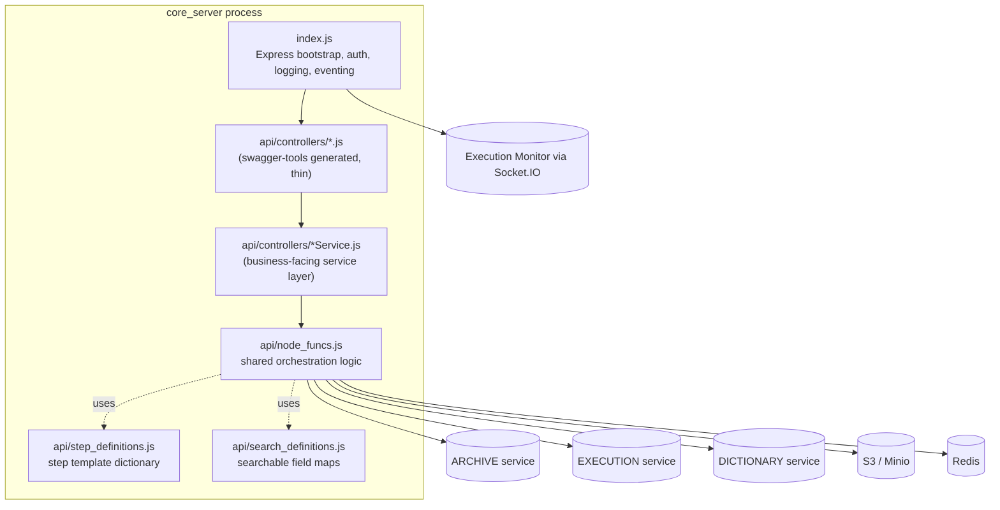
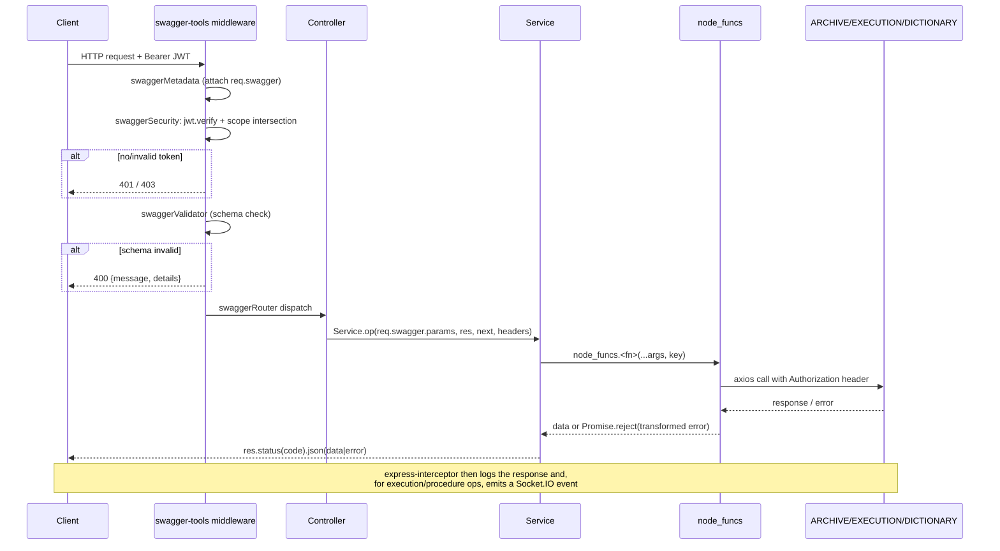

# Architecture

## Process-level shape

`core_server` is a single Node.js process (`index.js`) that:

1. Reads the OpenAPI 2.0 spec at `api/swagger/swagger.yaml` and initializes
   [`swagger-tools`](https://github.com/apigee-127/swagger-tools) middleware
   from it (`index.js:251-255`).
2. Chains Express middleware in this order (`index.js:41-338`):
   `express-timeout-handler` → `body-parser` (500 MB JSON/urlencoded limit) →
   request-logging middleware → `express-interceptor` (response
   logging/eventing) → `swaggerMetadata()` → `swaggerSecurity()` (JWT/scope
   check) → `swaggerValidator()` → `swaggerRouter()` (dispatches to
   `api/controllers/*`) → `swaggerUi()` → a final error handler that turns
   swagger validation failures into `400` responses.
3. Opens a Socket.IO client connection to `EXECUTION_MONITOR_URL`
   (`index.js:58-88`) used purely to **publish** events — `core_server` never
   listens for events on this socket.
4. Calls `node_funcs.init_file_server()` once at startup to ensure the Minio
   bucket (`config.MEDIA_BUCKET`) exists (`index.js:91-97`,
   `api/node_funcs.js:215-282`).

There is no separate worker/queue process, no background scheduler, and no
in-process database — confirmed by the absence of any `cron`, queue library,
or DB driver being invoked anywhere in `index.js` or `api/`.

## Component diagram

## Components and responsibilities

### `index.js` — HTTP bootstrap, authn/authz, eventing
Owns process-wide concerns that apply to every request: request timeout,
body-size limits, request logging, JWT verification + scope authorization
(the `UserSecurity` handler passed to `swaggerSecurity()`), and the
response **interceptor** that, after every successful `POST`/`PUT`/`PATCH`/
`DELETE`, emits an `execution-event` or `procedure-event` message over the
Execution Monitor socket and writes a structured Winston log entry
(`index.js:99-248`). See [Core Components](Core-Components.md#indexjs) for
details and [Data Flow](Data-Flow.md#request-lifecycle) for the full request
walkthrough.

### `api/controllers/*.js` — routed controllers
One file per swagger `x-swagger-router-controller` tag (confirmed against
`api/swagger/swagger.yaml`). Each function is a thin adapter:
`(req, res, next) => Service.operationId(req.swagger.params, res, next,
req.headers)`. Controllers contain **no business logic** — see
`api/controllers/Health.js` and `api/controllers/WAIT_DATA_PRODUCTS.js` for
representative examples.

### `api/controllers/*Service.js` — service layer
Contains the actual per-endpoint logic: pull swagger-parsed arguments out of
`args[name].value`, obtain the bearer token via
`node_funcs.get_auth_key(headers)`, call one or more `node_funcs` functions,
and map the result (or error) onto an HTTP response. This layer is
responsible for **HTTP status codes and response shaping only** — all
cross-cutting behavior (talking to ARCHIVE/EXECUTION/DICTIONARY, JWT
decoding, error normalization) lives in `api/node_funcs.js`.

There are two parallel families of step-type controller/service pairs,
enumerated authoritatively in `jest.config.js`:
- **Execution-side** (`stepModules`): `CMD`, `WAIT`, `VERIFY_EHA`, … — operate
  on `/executions/{execution_id}/...`.
- **Authoring-side** (`procedureStepModules`), each prefixed `Procedure_`:
  `Procedure_CMD`, `Procedure_WAIT`, … — operate on
  `/procedures/{procedure_id}/...`.

Both families ultimately call the *same* `node_funcs` functions
(`createArchiveElement`, `getStep`, `updateStep`, …), passing either
`execution_id` or `procedure_id` — `node_funcs` branches on which one is
non-null. This is why the archive's element model treats procedures and
executions symmetrically (see [Core Components](Core-Components.md#the-element-model)).

### `api/node_funcs.js` — the orchestration layer
A single ~6,000-line CommonJS module (no classes) exporting ~150 functions.
This is where nearly all business logic lives: HTTP calls to the sibling
services, JWT decode/verify helpers, the execution status state machine,
the redline (modify/justify/approve/discard) workflow, free-text search,
S3/Minio file storage, Redis-backed execution wait/switch coordination,
gzip export/import, and error normalization. See
[Core Components](Core-Components.md#apinode_funcsjs) for a full breakdown.

### `api/step_definitions.js` — step template dictionary
Exports `step_dict`, a map of step-type name → default specification
(`authoring_user_input` / `execution_user_input` / `results` schemas plus
`code`/`executable`/`verifiable` metadata). `node_funcs.createArchiveElement`
deep-copies the matching template whenever a new `STEP` or
`PROCEDURE_SECTION` element is created (`api/node_funcs.js:284-379`).

### `api/search_definitions.js` — searchable field maps
Exports field maps (`authoring_field_map`, `execution_field_map`,
`authoring_searchable_field_map`, `execution_searchable_field_map`,
`searchable_result_field_map`) that tell `node_funcs.searchExecution` /
`node_funcs.searchProcedureVersion` which dotted field paths are searchable,
whether a field is HTML (needs tag-stripping before matching), and whether a
match is safe to bulk-replace.

## Important abstractions

### The element model
Procedures and executions share one generic **element** hierarchy in the
archive: `elem_type` is one of `SECTION`, `PARAGRAPH`, `PROCEDURE_SECTION`,
`TOC`, or `STEP`; for `STEP` elements, `step_type` selects one of the ~30
templates in `step_definitions.js` (`CMD`, `WAIT_EHA`, `ANALYSIS`, …).
`core_server` does not model this hierarchy itself — it is a pass-through
shape enforced by `createArchiveElement` when composing the payload sent to
ARCHIVE (`api/node_funcs.js:284-379`).

### Procedure vs. execution symmetry
Every procedure-authoring operation (`Procedure_CMD`, `getProcedureElements`,
…) has a near-identical execution counterpart (`CMD`, `getExecutionElements`,
…) that targets `/executions/...` instead of `/procedures/...`. Many
`node_funcs` functions (e.g. `get_step_input`, `updateElement`,
`delete_element`) take **both** an `execution_id` and a `procedure_id`
parameter and branch on whichever is non-null, rejecting if neither is set.

### Execution state machine
Executions move through a fixed, ordered status list —
`EXEC_STATUSES = ['IDLE', 'RUNNING', 'PAUSED', 'HALTED', 'SUSPENDED',
'CLOSED', 'IN_REVIEW', 'FINALIZED']` (`api/node_funcs.js:61`). `CLOSED` is the
boundary between "open" and "complete" statuses (`_isOpenStatus` /
`_isCompleteStatus`, `api/node_funcs.js:4095-4107`); `updateExecutionStatus`
enforces that a completed execution can never transition back to an open
status, and drives side effects (halting, releasing the venue, removing
breakpoints) when transitioning to `CLOSED` or `SUSPENDED`
(`api/node_funcs.js:4109-4176`). See [Data Flow](Data-Flow.md#execution-lifecycle)
for the full transition diagram.

### Sub-procedure calling
A `PROCEDURE_SECTION` element can reference another procedure. "Calling" it
(`call_procedure_section`, `api/node_funcs.js:1928-2000`) suspends the
current execution, creates a **new, linked child execution** on the same
venue, copies the referenced procedure section into it, and imports its
elements — a nested-execution pattern not mentioned in the README. See
[Data Flow](Data-Flow.md#sub-procedure-call--import) for the full sequence.

### Redline / blueline workflow
Execution elements can be modified in place; each modification is tracked as
a change that must be **justified** and then **approved** or **discarded**
(`modifyElement` / `justifyElement` / `approveElement` / `discardElement` and
their bulk (`...Elements`) counterparts, all exported from
`api/node_funcs.js`). This is exposed on both single-element and
multi-element (`/elements/justify`, `/elements/approve`, `/elements/discard`)
endpoints per `api/swagger/swagger.yaml`.

## Control flow: a single request

## Related pages

- [Core Components](Core-Components.md) — per-module deep dive
- [Data Flow](Data-Flow.md) — concrete end-to-end workflows
- [API Reference](API-Reference.md) — the REST surface this architecture serves
- [Configuration](Configuration.md) — how sibling-service locations and secrets are supplied
