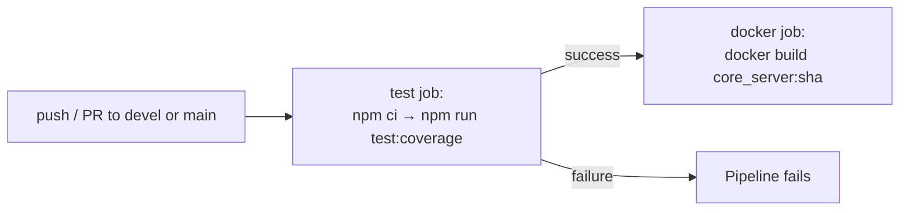

# CI/CD

This repository defines a single CI/CD pipeline: a GitHub Actions workflow
(`.github/workflows/ci.yml`).

## GitHub Actions — `.github/workflows/ci.yml`

**Triggers:** `push` and `pull_request` targeting `devel` or `main`.

**Concurrency:** grouped by `${{ github.workflow }}-${{ github.ref }}`, with
`cancel-in-progress: true` — a new push to the same branch cancels any
in-flight run for that branch.

**Permissions:** `contents: read` only.

### `test` job
Runs on `ubuntu-latest`:
1. `actions/checkout@v5`
2. `actions/setup-node@v5` with `node-version-file: '.nvmrc'` and
   `cache: 'npm'`
3. `npm ci`
4. `npm run test:coverage`

Any coverage-threshold violation (see [Testing](Testing.md#coverage-enforcement))
or test failure fails this job.

### `docker` job
Runs on `ubuntu-latest`, gated on `needs: test` (only runs if `test`
succeeds):
1. `actions/checkout@v5`
2. `docker build -t core_server:${{ github.sha }} .`

This job only verifies the image **builds**; it does not push, scan, or run
the resulting image. There is no separate "release" or "publish" job in this
workflow — no registry push step exists in `ci.yml`.



## Docker image

The `docker` job builds the same `Dockerfile` used for production:

```dockerfile
FROM node:22.23.2-slim
WORKDIR /app
COPY . /app
RUN npm ci --omit=dev && \
	mkdir /app/data
USER root
ENTRYPOINT ["npm", "start"]
```

Notes:
- `npm ci --omit=dev` — devDependencies (`jest`) are excluded from the
  production image; the image cannot run the test suite.
- `USER root` — the container runs as root; there is no non-root user
  configured.
- `/app/data` is created but not populated or referenced elsewhere in this
  repository's source — its purpose is **unknown / not documented**.

## Related pages

- [Testing](Testing.md)
- [Development](Development.md)
- [Security](Security.md)
