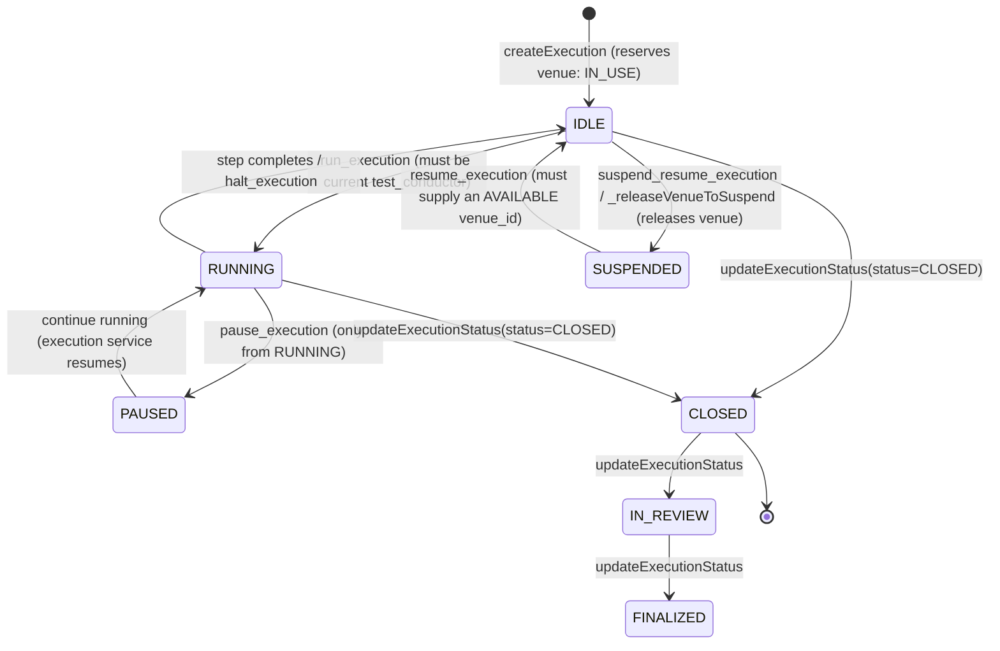
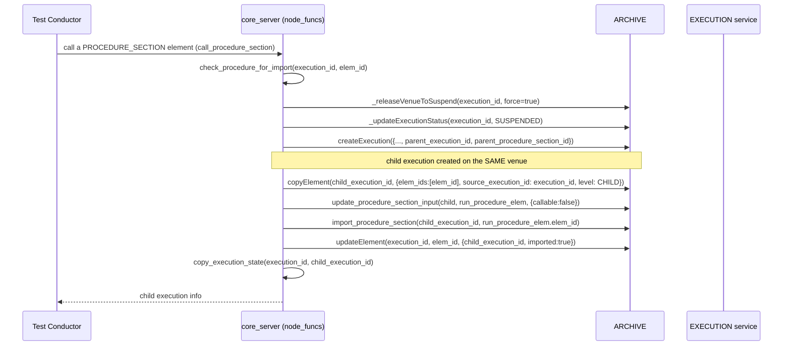

# Data Flow

Concrete, end-to-end walkthroughs of the workflows this service implements.
Each section names the real functions and files involved so you can jump
straight to the implementation.

## Request lifecycle

```text
Client request (Bearer JWT)
→ express-timeout-handler (starts the 290s timer)
→ body-parser (500MB limit)
→ request-logging middleware ([REQUEST] method url)
→ express-interceptor (registers itself; runs after the response is sent)
→ swaggerMetadata (attaches req.swagger: apiPath, operation, params)
→ swaggerSecurity → UserSecurity handler:
    - required_scopes == [] → skip check (e.g. /health)
    - no/invalid Authorization header → 401
    - jwt.verify fails → 403 "access denied: <error>"
    - jwt.verify succeeds but no scope intersection → 403 "user does not have the permission"
    - else → proceed, req.jwt = decoded token
→ swaggerValidator (schema check against swagger.yaml) → 400 on failure
→ swaggerRouter → api/controllers/<Name>.js → <Name>Service.js
    - Service reads args[...].value, calls node_funcs.get_auth_key(headers)
    - Service calls one or more api/node_funcs.js functions
    - node_funcs calls ARCHIVE / EXECUTION / DICTIONARY via axios,
      forwarding the caller's Authorization header
    - node_funcs normalizes any failure via transform_axios_error
    - Service maps the result/error to res.status(...).json(...)
→ express-interceptor.intercept (after send):
    - resolve user_name from the Authorization header
    - if params include execution_id → emit 'execution-event' over Socket.IO
    - else if params include procedure_id → emit 'procedure-event'
    - write a structured Winston log entry (level depends on status_code /
      execution status)
```

See [Architecture](Architecture.md#control-flow-a-single-request) for the
sequence-diagram form of this same flow.

## Execution lifecycle



Notes grounded in `api/node_funcs.js`:

- **Only the venue's current `test_conductor` may run a step**
  (`runExecution_`, `api/node_funcs.js:771-782`) or **continue** an execution
  (`continue_execution`, `api/node_funcs.js:4270-4287` — rejects with
  `http_code_at_source: 403` otherwise).
- **`updateExecutionStatus`** (`api/node_funcs.js:4109-4176`) is the guarded
  gateway for all status changes: transitioning **into** `CLOSED` cascades
  `halt_execution` → `remove_break_points` → `refresh_execution` → release
  the venue (only if this execution still holds it); transitioning into
  `SUSPENDED` releases the venue via `_releaseVenueToSuspend`. Once a status
  is "complete" (`CLOSED`/`IN_REVIEW`/`FINALIZED`), the execution can never
  transition back to an "open" status (`IDLE`/`RUNNING`/`PAUSED`/`HALTED`/
  `SUSPENDED`) — enforced by `_isOpenStatus`/`_isCompleteStatus`.
- **`resume_execution`** (`api/node_funcs.js:4851-4929`) requires the target
  execution to currently be `SUSPENDED` and the target venue to be
  `AVAILABLE` with no execution attached; it merges the resuming user into
  `test_conductors` if not already present, re-registers the execution with
  the EXECUTION service, and marks the venue `IN_USE` again.
- **`suspend_resume_execution`** (`api/node_funcs.js:4931-4969`) is a
  same-venue handoff: it requires the *current* execution to be `IDLE` and
  the *target* execution to be `SUSPENDED` on the **same venue**, then
  suspends the current one, copies select metadata
  (`mode`/`delay`/`pause_conditions`/`participants`/`redline_approvers`) and
  execution state (switch-wait flags, via `copy_execution_state`) onto the
  target, and resumes the target.
- **`halt_execution`** (`api/node_funcs.js:4234-4258`) is best-effort: a
  `404` from the EXECUTION service is treated as "already closed" and
  logged at `info`, not treated as an error; the archive execution status is
  always set to `IDLE` afterward regardless of whether the halt call
  succeeded.

## Procedure authoring & versioning

```text
createProcedure (author = JWT username)
→ add SECTION / PARAGRAPH / PROCEDURE_SECTION / STEP elements
   (createArchiveElement — deep-copies the step_dict template for STEP/PROCEDURE_SECTION,
    then deep-merges caller-supplied data on top)
→ createProcedureVersion (snapshots the current working elements into a version)
→ status: WORKING → VERSIONED → RELEASED
   (updateVersionStatus; legacy versions derive status from timestamps via
    deriveVersionStatus: no explicit status → OBSOLETE (deprecated) →
    RELEASED (time_released set) → VERSIONED (time_versioned set) → WORKING)
→ (optional) exportProcedureVersion(s) → gzip archive (targz)
→ (optional) importProcedureVersion(s) → extract gzip archive, rewrite file
   URLs (updateImportedProcedureElements) and re-post elements to ARCHIVE
```

An execution is always created **against a specific procedure version**
(`createExecution`'s `execution_input`, posted to ARCHIVE) — the procedure's
authored elements are the template an execution's own element tree starts
from; see [Core Components](Core-Components.md#procedure--version-lifecycle).

## Redline / blueline workflow

```text
Execution is RUNNING or has a completed step
→ modifyElement(execution_id, elem_id, modification, key)
    records a proposed change against the element
→ justifyElement(s)(execution_id, elem_id(s), justification, key)
    records why the change was made
→ approveElement(s)(execution_id, elem_id(s), key)
    OR discardElement(s)(execution_id, elem_id(s), key)
    finalizes or reverts the change
```

Distinct from this is the **step-result override** workflow
(`override_step` / `update_override_step` / `discard_override_step`,
`api/node_funcs.js:4492+`): it only applies to already-`EXECUTED` steps whose
recorded result is `PASS` or `FAIL`, flips it to `OVERRIDE_PASS`/
`OVERRIDE_FAIL`, and records `override_justification`, `overridden_by`
(from the JWT), and `time_overridden`.

## Sub-procedure call & import



Grounded in `call_procedure_section` (`api/node_funcs.js:1928-2000`). A
`PROCEDURE_SECTION` element that references another procedure can be
**imported** (elements copied inline into the current execution,
`import_procedure_section`) or **called** (spawns a new, linked child
execution that runs the referenced procedure independently while the
parent execution is suspended). A section can only be called if its
`execution_user_input.callable` is `true` and it has not already been
`imported`.

## File attachment upload

```text
multipart upload (file_content, optional file_name)
→ FileService.element_upload_file
→ node_funcs.writeFile(file_name, file_content, execution_id, elem_id, key)
    → upload_file(MEDIA_BUCKET, filename, buffer) — S3 PutObject to Minio,
      object key = <yyyy-mm-dd>/<uuid>/<filename> (api/node_funcs.js:2276+)
    → POST the resulting {file_name, url} as a FileInfo record to
      ARCHIVE .../elements/{elem_id}/files
```

The equivalent procedure-side path uses `procedureWriteFile`. Comment
attachments use `writeFileComment` / `writeFileProcedureComment`, which
follow the identical upload-then-register pattern against the
comment-nested `files` endpoint.

## Free-text search

```text
POST /executions/{execution_id}/search  {search_for, match_case, match_whole_word,
                                          step_type_filters, field_filters,
                                          status_filters, from_time, to_time,
                                          start_elem_id, end_elem_id}
→ searchExecution (api/node_funcs.js:2603+)
    1. fetch all elements for the execution (getExecutionElements, up to 10,000)
    2. resolve the field-path set to scan from search_definitions.js
       (field_filters narrows this; default is execution_searchable_field_map)
    3. build a regex via construct_regexp (case/whole-word aware)
    4. for each element inside the optional [start_elem_id, end_elem_id] window
       passing the step_type/status/time filters, scan each resolved field
       (HTML fields tokenized first) and collect matches
    5. return up to 1000 matches (100 match-texts per field), each tagged with
       elem_id/number/title/elem_type/step_type/field_path/is_html/replaceable
```

The procedure-version search (`searchProcedureVersion`) is the same
algorithm against `authoring_field_map`/`authoring_searchable_field_map`.

## Export / import archives

```text
GET  /executions/{execution_id}/export           → exportExecution
GET  /procedures/{procedure_id}/versions/{v}/export → exportProcedureVersion(s)
    1. fetch the full element tree (and attached files) for the target
    2. stage a JSON manifest (execution_export.json / procedure_export.json /
       procedure_version_export.json) plus file contents in a temp dir (tmp, fs-extra)
    3. gzip the staged directory with targz
    4. stream the resulting archive back to the client

POST /executions/import                          → importExecution
POST /procedures/{procedure_id}/import            → importProcedureVersion(s)
    1. extract the uploaded gzip archive to a temp dir (targz)
    2. read the manifest JSON
    3. rewrite embedded file URLs to the current MEDIA_BUCKET
       (updateImportedProcedureElements, file_path_* regex patterns,
       api/node_funcs.js:45-48)
    4. re-create the element tree in ARCHIVE under a new (or specified) id
```

This is the code path the coverage floor for `api/node_funcs.js` in
`jest.config.js` explicitly calls out as integration-heavy and not fully
unit-testable without real filesystem/archive I/O.

## Related pages

- [Architecture](Architecture.md)
- [Core Components](Core-Components.md)
- [API Reference](API-Reference.md)
- [Error Handling](Error-Handling.md)
