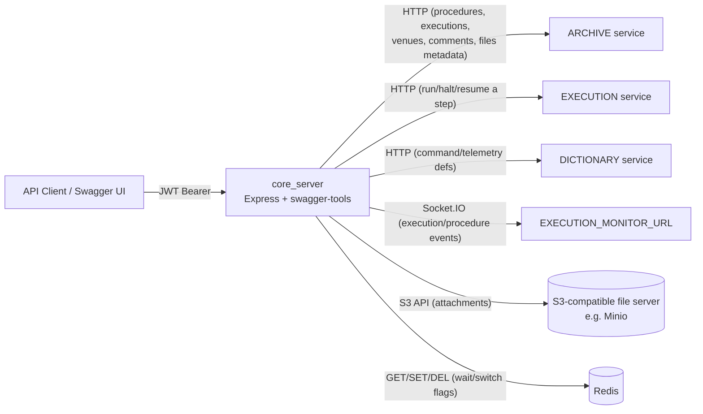

# Project Overview

## What it does

`core_server` (package name `ingenium-core-api`, service title "Ingenium Core
API") is the REST API that backs procedure authoring and execution for the
Ingenium spacecraft integration & test (I&T) platform. It lets test engineers:

- **Author** structured, versioned test procedures made of typed **steps**
  (commands, telemetry/EHA checks, EVR queries, manual verification, waits,
  custom scripts, sub-procedure calls, etc.), organized into sections,
  paragraphs, and a table of contents.
- **Execute** those procedures against a **venue** (`WSTS`, `Testbed`, `ATLO`,
  `Other`), tracking live status per step, redline/blueline changes,
  threaded comments, and file attachments.

This is established directly from `api/swagger/swagger.yaml` (`info.title:
Ingenium Core API`), the resource model in `api/node_funcs.js`, and the step
catalog in `api/step_definitions.js`.

## What it is *not*

`core_server` **owns no database or object store of its own**. Every read or
write of procedure/execution/venue data is proxied, via HTTP, to a sibling
**archive** service. `core_server` is a stateless orchestration/business-logic
layer sitting in front of several other Ingenium services — observed
throughout `api/node_funcs.js`, where nearly every exported function's body is
an `axios` call to one of `archiveLocation`, `executionLocation`, or
`dictionaryLocation` (`api/node_funcs.js:18-20`).

## High-level architecture

`core_server` is the single point every client (UI, CLI, or script) talks to;
it fans requests out to the services above and reshapes the responses. See
[Architecture](Architecture.md) for component responsibilities and
[Data Flow](Data-Flow.md) for concrete request walkthroughs.

## Key technologies

Observed in `package.json`:

| Concern | Technology |
|---|---|
| HTTP framework | [Express](https://expressjs.com/) 4.x |
| API contract / routing | [swagger-tools](https://github.com/apigee-127/swagger-tools) 0.10.1 driven by an OpenAPI (Swagger) **2.0** spec (`api/swagger/swagger.yaml`) |
| Auth | [jsonwebtoken](https://github.com/auth0/node-jsonwebtoken) — RS256 JWT verification |
| Outbound HTTP to sibling services | [axios](https://github.com/axios/axios) 0.19.x |
| Object storage client | [aws-sdk](https://github.com/aws/aws-sdk-js) v2 `S3` client (used against an S3-compatible endpoint, e.g. Minio) |
| Coordination store | [async-redis](https://github.com/edcarroll/async-redis) |
| Real-time eventing | [socket.io-client](https://socket.io/) — `core_server` acts as a Socket.IO **client** to an external Execution Monitor |
| Logging | [winston](https://github.com/winstonjs/winston) 3.x with custom levels and a JSON formatter |
| Archive/export format | [targz](https://www.npmjs.com/package/targz) for gzip'd procedure/execution export & import |
| Test framework | [Jest](https://jestjs.io/) 27.x |
| Runtime | Node.js, pinned to `22.23.2` via `.nvmrc` and `package.json#engines` |

`arangojs` appears in `package.json` dependencies but is **not required or
used** anywhere under `api/` or `index.js` (verified by searching the source
tree) — flagged here as an **unknown/unused dependency** rather than an
architectural fact.

Conversely, `index.js` `require('body-parser')` and `api/node_funcs.js`
`require('through2')`, but neither package is listed in `package.json`'s
`dependencies`/`devDependencies`. They currently resolve only because some
other declared dependency pulls them in transitively (Node's module
resolution finds any package present in `node_modules`, direct or not) — an
**observed fragility**: an unrelated dependency upgrade that drops that
transitive package would break `core_server` at `require`-time without any
change to `package.json` surfacing the cause.

## Where to go next

- [Architecture](Architecture.md) — component responsibilities and diagrams
- [Repository Structure](Repository-Structure.md) — directory-by-directory tour
- [Core Components](Core-Components.md) — deep dive on the business-logic layer
